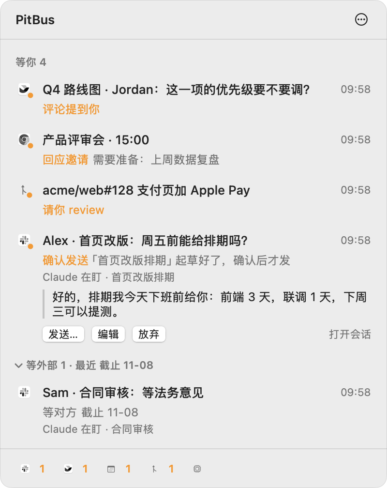
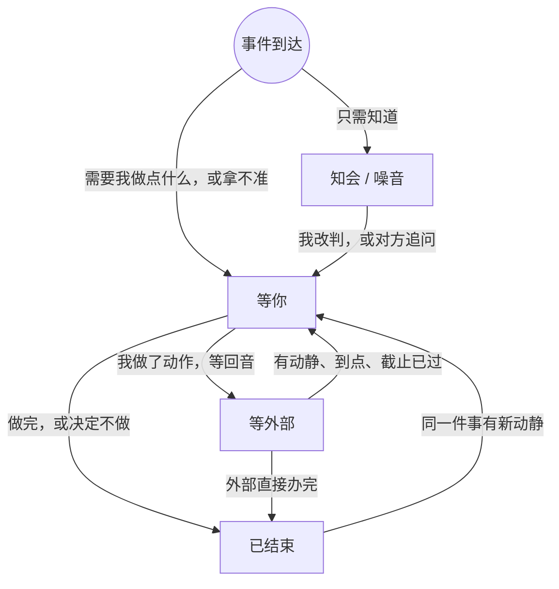

# PitBus

**An event bus for your agents.** PitBus wakes your Claude Code sessions when Slack, Feishu / Lark, Google Calendar, GitHub or a deadline moves, so an agent can wait for a reply without polling and without spending tokens. A macOS menu bar app shows what is waiting on you.

Mac 菜单栏里的「下一步该谁动」：PitBus 替你盯着 Slack、飞书文档评论、Google 日历、GitHub 和时间点，把每件事归到等你、等外部、已结束三个状态。Claude Code 会话可以登记自己在等什么，有动静时被叫醒，等待时不消耗 token。

  <picture>
    <source media="(prefers-color-scheme: dark)" srcset="docs/panel-dark.png">
    
  </picture>

截图里的人名、频道和链接都是假数据，由 <code>docs/mock-data.sh</code> 生成。

## 一件事的状态机

每个到达的事件回答两个独立的问题：我需要知道吗（信息），下一步该谁动（控制）。

- **信息：** 事件先分拣成噪音、知会和要处理。噪音只记日志，知会进「新消息」，看过即归档。
- **控制：** 要处理的事只有三个状态：等你、等外部、已结束。等别人、等 Claude 会话、等某个时间点，区别只在叫醒条件，所以是同一个状态。

状态机本身不保证事情不掉地上，PitBus 在写入时检查下面几条：

1. 以对象为单位：一个讨论串、私聊、文档、PR 是一件事，消息、订阅、超时都是它的事件。
2. 只有一个持有者：未结束的事要么在你手上，要么在一个明确的外部手上。
3. 等外部必带截止：到期回到等你，由你决定催、继续等或结束。
4. 回到等你必带原因：对方回复了、草稿待确认、截止过了没回音。原因就是你这一步要做的事。

## 安装

在这个目录里打开 Claude Code，对它说「按 CLAUDE-GUIDE.md 帮我装上 PitBus」。说明里写了前提、安装、配置、日常用法和边界，人也可以直接读。

## 目录

- `pit/pit.py`：常驻服务、命令行 `pit` 和 MCP 服务，只用 Python 标准库。
- `menubar/`：菜单栏应用（Swift + SwiftUI）。
- `skill/SKILL.md`：给 Claude 会话的 `pit-watch` 技能。
- `install.sh` / `uninstall.sh`：安装与卸载。
- `org/<公司>/`：某家公司自己加的渠道和规则，开源版不带。`./export-oss.sh <目录>` 导出不含 `org/` 的副本。

## 许可

MIT
